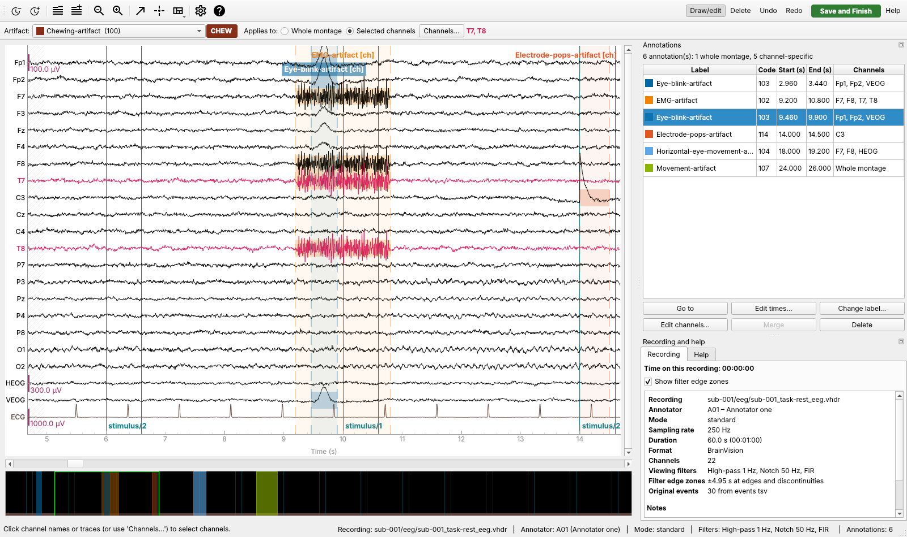

# ElectroClean

ElectroClean is a desktop application for the manual annotation of artifacts
in continuous EEG recordings, together with tools for measuring how
consistently different annotators work and for training and assessing new
annotators. It was written for a PhD project on EEG artifact identification
and on the development and evaluation of automated EEG cleaning.

It has three parts that share one annotation file format:

| Component | What it does | How to start it |
|---|---|---|
| **A. Annotation** | View continuous EEG (BrainVision, EDF/EDF+ or BDF) with MNE-Python's browser, mark artifact intervals with any of the 29 HED-SCORE artifact terms on the whole montage or on chosen channels, and save validated, BIDS-compatible outputs. Work is saved automatically until it is finished. | The ElectroClean application, `electroclean`, or a launcher in `launchers/` |
| **B. Inter-rater agreement** | Compare annotators by category, time and channel: time-resolved and event-based agreement, with an HTML report and tables. | `electroclean-agreement`, or *Tools → Inter-rater agreement analysis* |
| **C. Training and assessment** | Practice with feedback against expert references, blinded competency assessment with administrator-defined criteria, and an optional short-segment quiz. | Training modes in the start window; `electroclean-admin` and *Tools → Administrator tools* |

Everything runs locally without an internet connection, and the original EEG
files and metadata are never modified.



## Installation

### Stand-alone application (recommended for annotators)

Ready-to-run applications for Windows, macOS (Apple silicon, macOS 14 or
later) and Linux are on the
[Releases page](https://github.com/faisalmushtaq/ElectroClean/releases):
download `ElectroClean-windows-x64.zip`, `ElectroClean-macos-arm64.zip` or
`ElectroClean-linux-x64.zip`, unzip it and start *ElectroClean*. Nothing else
needs to be installed. Builds of the latest main branch are on the
repository's **Actions** tab (*Build applications*). The applications are not
signed with a developer certificate, so Windows and macOS ask for confirmation
the first time; [docs/building_apps.md](docs/building_apps.md) explains this
and how to build the applications yourself. Each application can check itself
with `ElectroClean --self-test`.

### From the source code

ElectroClean needs **Python 3.12 or 3.13** (64-bit) and runs on Windows,
macOS and Linux. The test-suite runs on all three systems for every push to
main (see `.github/workflows/build-apps.yml`).

**With the launchers (no Python knowledge needed)**

1. Install Python 3.12 or 3.13 from [python.org](https://www.python.org/downloads/).
   On Windows, tick *Add python.exe to PATH*.
2. Download or copy this folder to the computer.
3. Double-click the launcher for your system in the `launchers` folder:
   `ElectroClean.bat` (Windows), `ElectroClean.command` (macOS; the first time,
   right-click it and choose *Open*) or run `launchers/electroclean.sh` (Linux).

The first start creates a private environment in the `.venv` folder and
installs the exact library versions listed in `requirements.txt`. When
`requirements.txt` changes, or an installation was interrupted, the launcher
installs them again at the next start. This needs an internet connection;
afterwards ElectroClean works offline.

**Offline installation.** On a computer with internet access and the same
operating system and Python version, run
`python -m pip download -r requirements.txt -d wheels` inside this folder and
copy the folder, including `wheels`, to the offline computer. The launchers
install from `wheels` automatically when it is present.

**For developers**

```bash
python -m venv .venv
source .venv/bin/activate            # Windows: .venv\Scripts\activate
python -m pip install -r requirements-dev.txt
python -m pip install --no-deps -e .
python -m pytest                     # about 250 tests, under two minutes
electroclean                         # start the application
```

`requirements.txt` pins every package to the versions used for testing
(MNE 1.13.2, mne-qt-browser 0.7.5, PySide6 6.12.0, NumPy 2.5.4, SciPy 1.18.1,
pandas 3.1.0). `pyproject.toml` gives the compatible ranges.

## Try it with synthetic data

```bash
python examples/launch_demo_gui.py          # opens the app on a new synthetic dataset
python examples/demo_end_to_end.py          # runs the whole workflow without the GUI
```

The second command creates three synthetic recordings with known artifacts,
has three simulated annotators annotate them through the same session code the
application uses, runs the agreement analysis, and takes an annotator through a
competency assessment. Its outputs are kept in `examples/example_output/`.

## Annotating, in brief

On the start window enter your annotator ID (letters and digits, for example
`A01`), choose the folder with the recordings and press **Begin new session**.
ElectroClean finds every recording (`*_eeg.vhdr`, `*_eeg.edf` or `*_eeg.bdf`)
in that folder and its sub-folders, picks a recording you have not completed yet, asks which viewing filters to
use (1 Hz high-pass and 50 Hz notch by default, with 60 Hz available; they
change only the display), and opens it. Choose the artifact type in the
toolbar, choose *Whole montage* or *Selected channels*, and drag across the EEG
to mark an interval. Overlapping annotations of the same type on the same
channels are merged into one. Channels that only carry information about the
headset, such as the timestamp, contact-quality and battery channels in Emotiv
EDF exports, are not shown (the list is a setting). Your work is saved automatically as you go;
you can close the recording and finish it later. When you have reviewed the
whole recording, press **Save and Finish**. The
[user guide](docs/user_guide.md) explains every step with screenshots.

## What is saved

Results go to an `Annotated_Events` folder in the dataset folder (this can be
changed). For each recording and annotator ElectroClean writes five files
whose names start with the recording's name and the annotator, for example
`sub-001_task-rest_eeg_annotator-A01`:

| File | Contents |
|---|---|
| `…_events.tsv` | The recording's original events, unchanged, plus one row per artifact with `onset`, `duration`, `trial_type` (HED-SCORE term), `sample`, `channels` (JSON list; `[]` means the whole montage), `artifact_code` (fixed code, 100-136) and columns identifying the source, annotation and annotator. The `value` column keeps only the dataset's own marker codes, so they can never clash with artifact codes. |
| `…_events.json` | BIDS sidecar describing every column, the artifact codes and their HED tags. |
| `…_annotations.json` | The canonical, lossless record of the annotations, used by the agreement and training tools. |
| `…_time_viewed.txt` | One number: seconds spent annotating, measured with a monotonic clock. |
| `…_session.json` | Session metadata: times, software versions, filter design, checks and warnings. |

A recording is marked complete for that annotator, in
`completion_register.tsv` and in the annotator's `completed_datasets.txt`, only
after all five files have been written, read back and verified. Another
annotator can still annotate the same recording. Load failures are recorded in
`failed_load.txt` and `failure_log.jsonl`. The formats are specified in
[docs/file_formats.md](docs/file_formats.md); a real example is in
[`examples/example_output`](examples/example_output/Annotated_Events/annotator-A01/sub-001/eeg).

Example rows from an exported events file (an original event, then two
artifacts):

```text
onset  duration  trial_type          value  sample  channels              artifact_code  event_source           annotation_id  annotator_id  original_row
2.0    0.004     stimulus/1          1      500     n/a                   n/a            original:events_tsv    n/a            n/a           1
2.996  0.428     Eye-blink-artifact  n/a    749     ["Fp1","Fp2","VEOG"]  103            electroclean_artifact  d404c776…      A01           n/a
9.172  1.576     EMG-artifact        n/a    2293    ["F7","T7"]           102            electroclean_artifact  7a7ccd80…      A01           n/a
```

## Agreement analysis

```bash
electroclean-agreement path/to/Annotated_Events
```

This produces `agreement_report.html` and tab-separated tables, in a new
folder `agreement_<date-time>` (choose another with `--out`). The report opens
with the key results for each pair of annotators. Agreement is
reported by artifact category, by annotator pair and over time at several
resolutions, for time alone and for time and channel together, and with
event matching (precision, recall, F1, boundary differences). The
[reliability guide](docs/reliability_guide.md) explains each measure and its
assumptions.

## Training and assessment

An administrator prepares a *reference set* of expert-annotated recordings
(from one expert, a consensus of several, or an adjudicated consensus), marks
each as practice or assessment, and can set competency criteria. Annotators
choose *Training* or *Competency assessment* on the start window. Practice
gives immediate feedback and a side-by-side review against the reference;
assessment is blinded and ends with a reproducible competency report. See the
[administrator guide](docs/administrator_guide.md).

## Interaction logs

ElectroClean keeps a time-stamped log of each annotator's visit: clicks, keys
and shortcuts, what was on screen, every change to the annotations, dialogs and
idle periods (never the text typed into fields). `electroclean-activity` turns
the logs into tables (time, clicks and keys per recording, how much of each
recording was seen) and a report with learning curves, to show for example
whether annotators got faster. See [interaction logs](docs/activity_logs.md).

## Documentation

| Document | For |
|---|---|
| [User guide](docs/user_guide.md) | Annotators |
| [Administrator guide](docs/administrator_guide.md) | Study set-up, allocation, reference sets, competency criteria |
| [Reliability analysis guide](docs/reliability_guide.md) | Agreement measures and their interpretation |
| [Interaction logs](docs/activity_logs.md) | What is recorded about annotators' work, and the activity tables and learning curves |
| [File formats](docs/file_formats.md) | Every output and configuration file |
| [Developer guide](docs/developer_guide.md) | Architecture, MNE integration, extension points |
| [Testing guide](docs/testing_guide.md) | Running the tests, synthetic data, manual checks |
| [Design decisions](docs/design_decisions.md) | How the specification was interpreted, and questions for the research team |
| [HED-SCORE validation](docs/hed_score_validation.md) | Check of the 29 artifact terms against HED SCORE 2.2.0 |
| [Building the applications](docs/building_apps.md) | Stand-alone applications for Windows, macOS and Linux |
| [References](docs/references.md) | Literature cited in the documentation |

## Repository layout

```text
electroclean/
    app/            Component A: annotations, eeg, io, session, validation (no Qt) and gui (PySide6)
    reliability/    Component B
    training/       Component C
    config/         label catalogue, default settings, HED-SCORE validation snapshot
    synthetic.py    synthetic BrainVision, EDF and BDF data with known artifacts
tests/              pytest suite (unit, integration and offscreen GUI tests)
examples/           demo scripts and example outputs
docs/               documentation and screenshots
launchers/          double-click launchers (run from the source code)
packaging/          stand-alone application build (PyInstaller) and its self-test
scripts/            maintenance scripts (label validation, screenshots, third-party notices)
```

## Acknowledgements

ElectroClean is built on [MNE-Python](https://mne.tools) and its Qt browser
(Gramfort et al., 2013), uses the HED-SCORE artifact vocabulary (Hermes et
al., 2025) and follows the EEG-BIDS conventions (Pernet et al., 2019). Full
references are in [docs/references.md](docs/references.md).

## Licence

ElectroClean is free for research, teaching and any other non-commercial use
under the [PolyForm Noncommercial License 1.0.0](LICENSE.md); commercial use
needs permission from the copyright holders. The libraries it uses keep their
own licences (see [THIRD_PARTY_NOTICES.md](THIRD_PARTY_NOTICES.md); Qt for
Python is used under the LGPL 3.0).
