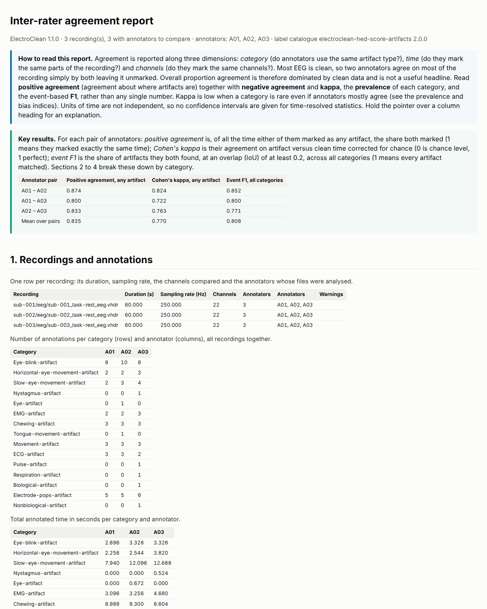

# ElectroTag

ElectroTag is research software for the manual annotation of artifacts in
continuous EEG recordings, together with tools for measuring how consistently
different annotators work and for training and assessing new annotators. It
was written for a PhD project on EEG artifact identification and on the
development and evaluation of automated EEG cleaning.

Annotators use ElectroTag in a web browser. They open the recordings they
were given from their own computer and the page reads them there, so the EEG
is never uploaded: a study holds only each recording's fingerprint (its
SHA-256 checksum), timing, channels and events, which identify the file the
annotator opened. They mark artifact intervals with any of the 29 HED-SCORE
artifact terms, on the whole montage or on chosen channels, and their results
are saved as validated, BIDS-compatible files. Lead researchers run the study
from the admin area of the same application.

| Part | What it does | Where |
|---|---|---|
| **Annotation** | View continuous EEG (EDF, EDF+, BDF or BrainVision), mark artifacts by mouse, keyboard or touch (on a computer or an iPad), and save with Save and Finish; unfinished work is kept as a draft. | The browser application |
| **Inter-rater agreement** | Compare annotators by category, time and channel: time-resolved and event-based agreement, with an HTML report and tables. | The admin area, or `electrotag-agreement` |
| **Training and assessment** | A training programme from guided learning with the experts to practice with a pass mark, a blinded competency assessment with criteria set by the study, and a short-segment quiz. | The browser application; set up in the admin area or with `electrotag-admin` |
| **Interaction logs** | A time-stamped record of how each annotator works, as research data, with tables and learning curves. | The admin area, or `electrotag-activity` |

The original EEG files and their metadata are never modified.

Version 1.1.0, released on 27 October 2026, was the last version of the
desktop application (Windows, macOS and Linux, built on MNE-Python's Qt
browser). It remains available on the
[Releases page](https://github.com/faisalmushtaq/ElectroTag/releases); its
results folders are read by the analyses below unchanged.

## Trying it

The browser application is published at
<https://faisalmushtaq.github.io/ElectroTag/>. Opened without a study, it is
a demonstration that needs no server and keeps everything in the browser: sign
in as A01 to annotate or as T01 for the training programme, with the password
`demo`. Three example recordings with simulated artifacts are built in, and
can also be downloaded as EDF files and opened from your computer, as
annotators open real recordings.

To try the whole system on one computer, with a real study server, install
the Python package (below) and run:

```bash
electrotag-web demo        # the application and a study server on http://localhost:8000/
```

[docs/web/server.md](docs/web/server.md) lists the accounts and where the
recordings to open and the results are.

## Running a study

A real study runs on **Firebase**: Firebase Authentication for the accounts,
Firestore in Google's London region (europe-west2) for the study's records,
and ElectroTag's Python Cloud Functions for the private work (matching a file
to the study, validating and saving results with ElectroTag's own code,
checking guided training steps and scoring practice, so the experts' answers
never reach a browser). [docs/web/firebase.md](docs/web/firebase.md) sets one
up step by step. A study can instead run on the **ElectroTag server**
(`electrotag-web serve`, [docs/web/server.md](docs/web/server.md)), on a
computer the study controls; both run the same Python service layer.

The lead researcher adds recordings, accounts and assignments, changes the
settings, prepares reference sets and follows progress in the admin area
([docs/web/admin.md](docs/web/admin.md)); the
[administrator guide](docs/administrator_guide.md) explains every setting and
choice. Annotators follow [docs/web/using.md](docs/web/using.md).

## The Python package

ElectroTag's Python package holds the study server, the Firebase functions'
code and the commands, all built on one core that reads recordings with
MNE-Python and writes and verifies the result files. It needs **Python 3.12 or
3.13** (64-bit) and runs on Windows, macOS and Linux. From a copy of this
repository:

```bash
python -m venv .venv
source .venv/bin/activate            # Windows: .venv\Scripts\activate
python -m pip install -r requirements.txt
python -m pip install --no-deps -e .
python -m electrotag               # lists the commands
```

| Command | For |
|---|---|
| `electrotag-web` | The study server and the demonstration, and the administrator's commands for a study: create it, register recordings, add accounts, assign work, follow progress and export the results |
| `electrotag-agreement` | Inter-rater agreement of saved annotations |
| `electrotag-admin` | Reference sets, competency criteria and the training programme, in a dataset folder or a server's study folder |
| `electrotag-activity` | Tables and learning curves from the interaction logs |

`requirements.txt` pins every package to the versions used for testing
(MNE 1.13.2, NumPy 2.5.4, SciPy 1.18.1, pandas 3.1.0, FastAPI 0.162.0,
firebase-admin 7.7.0); `pyproject.toml` gives the compatible ranges. The
browser application itself needs nothing installed: it is static files
(`electrotag/web/static`) with no build step.

For development, `requirements-dev.txt` adds the test tools:

```bash
python -m pip install -r requirements-dev.txt
python -m pip install --no-deps -e .
python -m pytest                              # the Python tests, a few minutes
node --test web_tests/unit/*.test.mjs         # the browser modules (Node.js 22)
```

The [testing guide](docs/testing_guide.md) describes these and the tests of
the application in Chromium and on Firebase's emulators.

## What is saved

For each recording and annotator ElectroTag writes five files whose names
start with the recording's name and the annotator, for example
`sub-001_task-rest_eeg_annotator-A01`, into an `Annotated_Events` folder: in
the study folder of an ElectroTag server as each recording is saved, and for
a study on Firebase when `electrotag-web export` writes the study's results
to your computer.

| File | Contents |
|---|---|
| `…_events.tsv` | The recording's original events, unchanged, plus one row per artifact with `onset`, `duration`, `trial_type` (HED-SCORE term), `sample`, `channels` (JSON list; `[]` means the whole montage), `artifact_code` (fixed code, 100-136) and columns identifying the source, annotation and annotator. The `value` column keeps only the dataset's own marker codes, so they can never clash with artifact codes. |
| `…_events.json` | BIDS sidecar describing every column, the artifact codes and their HED tags. |
| `…_annotations.json` | The canonical, lossless record of the annotations, used by the agreement and training tools. |
| `…_time_viewed.txt` | One number: seconds spent annotating, measured on a monotonic clock while the recording was open. |
| `…_session.json` | Session metadata: times, software versions, filter design, checks and warnings. |

A recording is marked complete for that annotator, in
`completion_register.tsv` and in the annotator's `completed_datasets.txt`, only
after all five files have been written, read back and verified. Another
annotator can still annotate the same recording. The formats are specified in
[docs/file_formats.md](docs/file_formats.md); a real example is in
[`examples/example_output`](examples/example_output/Annotated_Events/annotator-A01/sub-001/eeg).

Example rows from an exported events file (an original event, then two
artifacts):

```text
onset  duration  trial_type          value  sample  channels              artifact_code  event_source           annotation_id  annotator_id  original_row
2.0    0.004     stimulus/1          1      500     n/a                   n/a            original:events_tsv    n/a            n/a           1
2.996  0.428     Eye-blink-artifact  n/a    749     ["Fp1","Fp2","VEOG"]  103            electrotag_artifact  d404c776…      A01           n/a
9.172  1.576     EMG-artifact        n/a    2293    ["F7","T7"]           102            electrotag_artifact  7a7ccd80…      A01           n/a
```

`python examples/demo_end_to_end.py` runs the whole workflow without a
browser: it creates three synthetic recordings with known artifacts, has three
simulated annotators annotate them through the same session code that saves
the browser's work, runs the agreement analysis, and takes an annotator through
a competency assessment. Its outputs are kept in `examples/example_output/`.

## Agreement analysis

```bash
electrotag-agreement path/to/Annotated_Events
```

This produces `agreement_report.html` and tab-separated tables, in a new
folder `agreement_<date-time>` (choose another with `--out`). The report opens
with the key results for each pair of annotators. Agreement is reported by
artifact category, by annotator pair and over time at several resolutions, for
time alone and for time and channel together, and with event matching
(precision, recall, F1, boundary differences). The admin area runs the same
analysis on the study's results. The
[reliability guide](docs/reliability_guide.md) explains each measure and its
assumptions.



## Training and assessment

A lead researcher prepares a *reference set* of expert-annotated recordings
(from one expert, a consensus of several, or an adjudicated consensus), marks
each recording for guided learning, practice or assessment, and can set
competency criteria. An annotator enrolled in the training programme first
learns with the experts, one artifact at a time with specific feedback, then
annotates practice recordings on their own until one reaches the pass mark,
and then takes the blinded assessment, which ends with a reproducible
competency report. The experts' annotations stay with the study and never
reach the browser. See the [administrator guide](docs/administrator_guide.md).

## Interaction logs

ElectroTag keeps a time-stamped log of each annotator's visit: clicks, keys
and shortcuts, what was on screen, every change to the annotations, dialogs and
idle periods (never the text typed into fields or passwords). The admin area
and `electrotag-activity` turn the logs into tables (time, clicks and keys
per recording, how much of each recording was seen) and a report with learning
curves, to show for example whether annotators got faster. See
[interaction logs](docs/activity_logs.md).

## Documentation

| Document | For |
|---|---|
| [Using ElectroTag](docs/web/using.md) | Annotators |
| [The admin area](docs/web/admin.md) | Lead researchers running a study in the browser |
| [Running a study on Firebase](docs/web/firebase.md) | Setting up a real study, step by step |
| [The ElectroTag server](docs/web/server.md) | The demonstration, and a study on your own server |
| [Administrator guide](docs/administrator_guide.md) | What every setting and choice of a study means: channels, filters, allocation, reference sets, competency criteria, the training programme |
| [Reliability analysis guide](docs/reliability_guide.md) | Agreement measures and their interpretation |
| [Interaction logs](docs/activity_logs.md) | What is recorded about annotators' work, and the activity tables and learning curves |
| [File formats](docs/file_formats.md) | Every output and configuration file |
| [Architecture](docs/web/architecture.md) and [API](docs/web/api.md) | How the browser application works, and the contract between browser and server |
| [Developer guide](docs/developer_guide.md) | The Python core, the save transaction, extension points |
| [Testing guide](docs/testing_guide.md) | Running the tests, synthetic data, checks that need a person |
| [Design decisions](docs/design_decisions.md) | How the specification was interpreted, the decisions taken, and questions for the research team |
| [HED-SCORE validation](docs/hed_score_validation.md) | Check of the 29 artifact terms against HED SCORE 2.2.0 |
| [References](docs/references.md) | Literature cited in the documentation |
| [Changes](CHANGELOG.md) | What changed in each release, and what is unreleased |
| [Handover notes](HANDOVER.md) | Where the project stands, what is open, and how to carry on |

## Repository layout

```text
electrotag/
    app/            the annotation core: annotations, EEG loading, file IO, validation, the session save
    reliability/    inter-rater agreement
    training/       reference sets, the training programme, competency assessment, the quiz
    activity/       interaction logs turned into tables and learning curves
    web/            the study server, the Firebase functions and the browser application (web/static)
    config/         label catalogue, default settings, HED-SCORE validation snapshot
    synthetic.py    synthetic BrainVision, EDF and BDF data with known artifacts
tests/              Python tests (pytest)
web_tests/          tests of the browser application (node --test and Playwright)
examples/           demonstration scripts and example outputs
docs/               documentation
scripts/            maintenance scripts (label validation, test recordings, third-party notices)
```

## Acknowledgements

ElectroTag is built on [MNE-Python](https://mne.tools) (Gramfort et al.,
2013), whose reading and filtering of recordings the browser application
reproduces, uses the HED-SCORE artifact vocabulary (Hermes et al., 2025) and
follows the EEG-BIDS conventions (Pernet et al., 2019). Full references are in
[docs/references.md](docs/references.md).

## Licence

ElectroTag is free for research, teaching and any other non-commercial use
under the [PolyForm Noncommercial License 1.0.0](LICENSE.md); commercial use
needs permission from the copyright holders. The libraries it uses keep their
own licences (see [THIRD_PARTY_NOTICES.md](THIRD_PARTY_NOTICES.md)).
