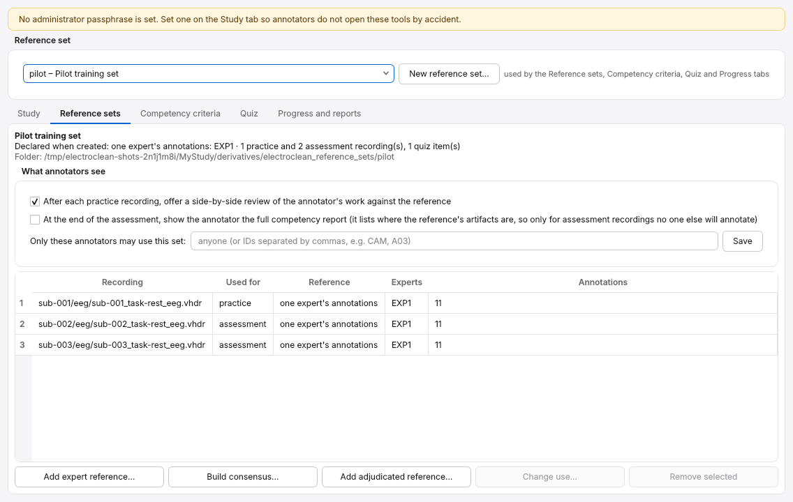
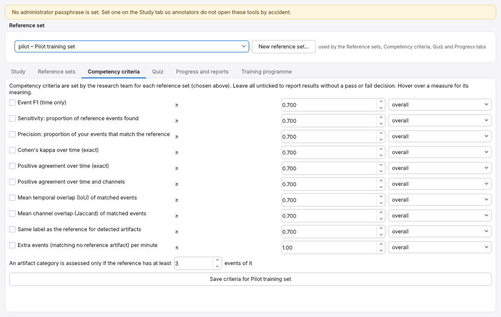

# Administrator guide

This guide is for the researcher who sets up a study: which annotators take
part, which recordings each annotates, how the viewer is configured, and how
annotators are trained and assessed. Most tasks can be done in the
application (*Tools → Administrator tools* on the start window), and all of
them with the `electroclean-admin` command; `electroclean-admin <command>
--help` lists each command's options. A few need the command (or a text
editor): the consensus options `--min-agreement`, `--merge-gap` and
`--min-duration` (the application uses a strict majority and no merging),
marking a load failure as resolved (`resolve-failure`), the matching settings
of a reference set (its `analysis` entry) and replacing a forgotten
administrator passphrase (`set-passphrase`).

## The study configuration

A study is configured by an optional file `electroclean_study.json` in the
dataset folder (format in [file_formats.md](file_formats.md)). Without it,
ElectroClean uses its defaults and any annotator can work on any recording.

```bash
electroclean-admin init-study /data/MyStudy --study-id pilot-2026 \
    --annotators A01:"First annotator" A02 CAM:Cameron --listed-only
electroclean-admin set-passphrase /data/MyStudy
electroclean-admin show /data/MyStudy
```

The **administrator passphrase** keeps annotators out of the administrator
tools by accident. It is stored as a salted PBKDF2 hash. It is not a security
boundary: anyone who can read the dataset folder can read its files.



## Recording formats and headset channels

ElectroClean opens BrainVision (`*_eeg.vhdr` with its `.eeg` and `.vmrk`
files), EDF and EDF+ (`*_eeg.edf`) and BDF (`*_eeg.bdf`) recordings, all read
with MNE-Python, and finds all three by default. To restrict a study to one
kind, set `"discovery": {"suffixes": ["_eeg.edf"]}` in the `settings` of the
study file. Before an EDF or BDF file is opened, its header is compared with
the file size: a file that holds fewer or more data records than its header
announces (for example an interrupted copy) is refused, as is an EDF+D file,
whose data records are not contiguous in time (MNE reads such files as if they
were continuous, so annotation times would be wrong). When the original
events have no `events.tsv`, the annotations stored in an EDF+ or BDF+ file
are used as the original events. Stretches the file marks as `BAD_ACQ_SKIP`
(MNE writes this, for example, for the padding of the last data record when it
exports EDF) are hatched in the viewer and filtered separately.

Some headsets, Emotiv's among them, export housekeeping signals as extra
"EEG" channels: timestamps, sample counters, contact and signal quality, battery
level and marker channels. Shown next to the EEG they would crowd the display,
and in the channel analyses a whole-montage annotation would count them as
annotated channels. The setting `channels.hide` lists names (with `*` and `?`
as wildcards, case-sensitive) of channels that are not shown and cannot be
annotated. By default it lists the housekeeping channels of Emotiv EDF exports
(`TIME_STAMP_s`, `COUNTER`, `INTERPOLATED`, `RAW_CQ`, `BATTERY`,
`MarkerValueInt`, `CQ_*`, `EQ_*` and so on); a study file can replace the list,
for example with `"channels": {"hide": []}` to show every channel. Hidden
channels are listed in every annotation and session file, and the
annotations' "whole montage" means the channels that were shown. Keep the
setting the same for all annotators of a study: files made with different
lists are compared on the channels they share, with a warning.

## Fixing the viewing filters

The defaults are a 1 Hz high-pass and a 50 Hz notch filter, both zero-phase FIR
filters with MNE's default design; annotators may switch the notch to 60 Hz
for recordings made with 60 Hz mains. For a reliability study all annotators
should see the same filtered signal, so you can fix the filters:

```bash
electroclean-admin fix-filters /data/MyStudy                     # 1 Hz high-pass, 50 Hz notch, FIR
electroclean-admin fix-filters /data/MyStudy --notch 60          # for 60 Hz mains
electroclean-admin fix-filters /data/MyStudy --no-highpass --notch off
electroclean-admin unlock-filters /data/MyStudy
```

Annotators then see the settings in the viewing-options window but cannot
change them, and every session file records that they were fixed. The filter
design (FIR, zero phase, MNE's default Hamming-windowed `firwin` design) and
the exact lengths and transition bands chosen by MNE are written to each
session file. A 1 Hz FIR high-pass at MNE's defaults is 3.3 s long and the
FIR notch is 6.6 s long, so up to about 5 s at each recording edge and around
each discontinuity can be affected; these zones are hatched in the viewer.

## The display

The `display` settings choose how the EEG first appears: `scalings` (the
amplitude per channel type, in volts; the scale bar shows twice the value),
`duration_s` (seconds shown, 10 by default) and `n_channels` (channels shown
at once, 32 by default, so that a 10-20 montage with its EOG and ECG channels
fits without scrolling). Annotators can still change the amplitude with − and
+, and their choice is kept for the next recording they open and written to
each session file (`display` in session.json), so you can see at what scale
each recording was annotated. For a reliability study it helps to choose a
starting scale that suits the data. The default (50 µV, `5e-05`) suits
clinical EEG; low-density consumer headsets such as Emotiv's record larger
signals, and `1e-4` (a 200 µV scale bar) keeps neighbouring channels apart:

```json
{"settings": {"display": {"scalings": {"eeg": 1e-4}}}}
```

## Which recordings each annotator sees

`electroclean-admin allocation /data/MyStudy random` (the default) offers a
random recording the annotator has not completed. `seeded --seed 7` gives each
annotator a reproducible order (derived from the seed and the annotator ID).
For a controlled overlap, create manual assignments:

```bash
electroclean-admin allocate /data/MyStudy --annotators A01 A02 A03 CAM \
    --raters-per-recording 2 --seed 7
```

This assigns every recording to exactly two of the four annotators, balancing
workload and the number of recordings each pair shares, and switches the study
to manual allocation. The assignments are stored in the study file, where they
can also be edited by hand.

Completion is recorded per annotator: a recording completed by A01 remains
available to A02. A recording an annotator has completed is never offered to
them again and their files are never overwritten.

## Original event codes and artifact codes

Artifact codes (100 to 121 for the specific types, 130 to 136 for the group
terms) are written to their own `artifact_code` column. The `value` column
keeps only the dataset's own marker codes, so a recording whose events already
use, say, code 101 needs no special treatment: the original 101 stays in
`value` and an ECG artifact gets 101 in `artifact_code`. There is nothing to
configure. Original codes are never renumbered. Repeated codes (many trials
sharing one code) are normal and are only counted; a code used for different
event types, or one type appearing with different codes, is reported in each
session file for you to review, as are original events that already use
HED-SCORE artifact names. Older study files that still set
`events.collision_policy` are accepted; the setting is no longer used.

## Load failures

Recordings that cannot be opened (missing or renamed companion files, a
truncated data file, an EDF file whose header and size disagree, a malformed
`events.tsv`, and so on)
are listed in `Annotated_Events/failed_load.txt` and `failure_log.jsonl`. They
are not offered again until the files change, the setting that caused the
failure changes, or you mark the failure resolved. Problems that may belong to
one computer or moment (running out of memory, a filter error, a permission
problem, an unexpected error) only hold the recording back from the annotator
who met them; problems with the files hold it back from everyone. To mark a
failure resolved:

```bash
electroclean-admin resolve-failure /data/MyStudy sub-007/eeg/sub-007_task-rest_eeg.vhdr --note "re-copied from source"
```

`resolve-failure` refuses a recording that has no unresolved failure in the
log, so a mistyped path cannot be marked resolved. More generally, every
`electroclean-admin` command refuses a dataset folder that does not exist,
and (except `init-study --create`) one that holds neither recordings nor a
study file, so a typing mistake cannot create a stray study file.

The *Progress and reports* tab of the administrator tools lists unresolved
failures.

## Interrupted saves

If ElectroClean stops while saving (power cut, network drive disconnected),
the next start finds the interrupted save. If every file had been written and
verified, the save is completed; otherwise the partial files are moved to
`Annotated_Events/.electroclean/interrupted/` and the recording stays
incomplete. Either way, a message tells the annotator what happened.

## Unfinished work (autosave)

While an annotator works, ElectroClean saves their unfinished annotations and
time every few seconds in `Annotated_Events/.electroclean/autosave/`. If
ElectroClean or the computer stops, or the annotator chooses *Close and
finish later*, the next session offers to continue. Autosaves are never
results: the agreement analysis and the completion register only ever see
recordings finished with Save and Finish. An autosave that no longer matches
its recording (because the recording files were replaced), or that the
annotator chose not to restore, is moved to
`.electroclean/interrupted/autosave/` rather than deleted.

## Training and competency assessment

### Reference sets

A reference set is a group of recordings with expert reference annotations,
each marked for **practice** or **assessment**. The references must be
prepared independently of the people being assessed, so that, for example,
Cameron can be trained and assessed without having produced any of the
reference material himself. The method used is stored as provenance with each
reference.

In the administrator tools, the reference set chosen at the top of the window
is the one that the *Reference sets*, *Competency criteria*, *Quiz* and
*Progress and reports* tabs work on. Each of the three *Add* buttons asks
whether the new reference is for practice or for assessment. There is no
default, because a reference imported for practice by mistake would give
annotators feedback on an assessment recording. *Change use…* switches the
selected recording between the two; when annotators have already completed
the recording in practice, ElectroClean names them and warns that the
assessment would not be blinded for them.

```bash
electroclean-admin create-reference-set /data/MyStudy pilot --name "Pilot set" \
    --method consensus --experts E1 E2 E3
```

There are three ways to establish a reference:

1. **One designated expert.** The expert annotates the recording in
   ElectroClean in standard mode, then you import the expert's
   `_annotations.json` file:
   `electroclean-admin add-reference /data/MyStudy pilot path/to/E1_annotations.json --use practice`.
2. **Consensus of several experts.**
   `electroclean-admin build-consensus /data/MyStudy pilot E1.json E2.json E3.json --use assessment --disagreements dis.tsv`.
   A sample is in the consensus for a category when at least
   `--min-agreement` experts marked it (a strict majority by default). For each
   consensus interval the channels are those chosen by at least as many of the
   contributing experts, and the interval is whole-montage when enough experts
   used whole montage. `--merge-gap` joins consensus intervals separated by
   at most that many seconds and `--min-duration` then drops shorter
   intervals (both 0 by default). The disagreement list has one row for each
   stretch of time that the same subset of experts (some but not all) marked,
   saying whether it ended up in the consensus, and one row for each consensus
   interval where the experts chose different channels, giving every expert's
   selection and the consensus result.
3. **Adjudication.** Give the disagreement list to an adjudicator, who
   annotates the recording (in standard mode, in a separate results folder) to
   produce the final version, and import it:
   `electroclean-admin add-adjudicated /data/MyStudy pilot final.json --use assessment --experts E1 E2 E3 --adjudicator E4 --expert-files E1.json E2.json E3.json --disagreements dis.tsv`.

Imported files are copied into the reference set with their checksums, and a
reference file that has been edited afterwards is refused. Keep reference sets
somewhere annotators do not browse (set `training.reference_sets_dir` in the
study file); by default they are in `derivatives/electroclean_reference_sets`.

To restrict a reference set to particular annotators, type their IDs under
*Only these annotators may use this set* on the *Reference sets* tab, or run
`electroclean-admin assign /data/MyStudy pilot CAM A03`.

The *What annotators see* box on the same tab holds two settings of the
reference set (stored in its `reference_set.json`). `practice_review` (on by
default) offers a side-by-side review against the reference after each
practice recording. `show_full_report_to_annotator` (off by default) lets
annotators open the full competency report at the end of their assessment.
That report lists the reference's artifacts that were missed, with their
times and channels, so turn it on only when no one else will annotate the
same assessment recordings. Reference sets made with version 1.0 could set
this as `show_report_to_annotator` in the `quiz` entry; that key is still
read.

### Competency criteria

ElectroClean does not impose a universal threshold: no criteria are set until
you set them, and reports then say "not determined". Choose criteria from
pilot data, expert agreement and the intended use of the labels. In the
administrator tools, hovering over a measure explains it, and thresholds can
only take values the measure can have (0 to 1 for proportions, -1 to 1 for
kappa).



| Metric | Meaning |
|---|---|
| `event_f1` | F1 of matched events (time only) |
| `event_recall` | Proportion of reference artifacts found |
| `event_precision` | Proportion of the annotator's artifacts that match the reference |
| `time_kappa` | Cohen's kappa over time (exact) |
| `time_positive_agreement` | Positive agreement over time |
| `channel_positive_agreement` | Positive agreement over time and channels |
| `mean_iou` | Mean temporal overlap of matched artifacts |
| `mean_channel_jaccard` | Mean channel overlap of matched artifacts |
| `label_accuracy` | Proportion of detected artifacts given the reference's label |
| `false_positives_per_min` | Annotations matching no reference artifact of any category, per minute (lower is better); an artifact found with a different label counts towards `label_accuracy` instead |

Each criterion applies **overall** or **in every assessed category**. A
category is judged only when the reference contains at least
`min_reference_events` events of it (3 by default); others are reported but
not judged. The result is "not determined" when a criterion cannot be
evaluated: for example a per-category criterion when no category has enough
reference events, or `mean_iou` when no artifact was matched at all. Pairing
`mean_iou`, `event_precision` or `label_accuracy` with `event_recall` or
`event_f1` therefore avoids undetermined results for annotators who find
very little. It is also "not determined" when an assessment recording could
not be compared with its reference (for instance because the annotator's file
refers to a different version of the recording); the report lists the
reasons.

```bash
electroclean-admin set-criteria /data/MyStudy pilot \
    --criterion event_f1:0.8 --criterion event_recall:0.7:each_category \
    --criterion label_accuracy:0.85 --min-reference-events 3
```

Matching for competency uses the defaults of the reliability analysis (IoU of
at least 0.2, one-to-one); a reference set can override them in the
`analysis` entry of its `reference_set.json`. The ANY-artifact rows and both
channel modes are always computed for assessments, because the competency
measures are based on them.

Each competency report carries a `results_sha256` digest of its contents.
`electroclean.training.assessment.verify_competency_report(path)` recomputes
it from the saved JSON file, and regenerating a report from the same files
gives the same digest.

### What annotators experience

In **practice** mode annotators see feedback after each recording and can
review their annotations next to the reference (theirs shaded, the
reference's hatched). In **assessment** mode they see nothing until all
assessment recordings are complete; ElectroClean then writes the competency
report to `Annotated_Events/training/<set>/reports/` and shows the annotator
a summary: the overall result, the table of criteria and what to do next. The
full report is for you (see `show_full_report_to_annotator` above). The
annotation window's title shows how far they are, for example "assessment
recording 1 of 2". Practice and assessment annotations are stored under
`Annotated_Events/training/` and are never mixed with research annotations.

### Competency reports

```bash
electroclean-admin progress /data/MyStudy pilot --annotators CAM A03
electroclean-admin report /data/MyStudy pilot CAM
```

The report lists each criterion with its value and result, the overall
measures and the measures by artifact type (with a glossary), the missed,
extra and relabelled artifacts, the matching rule in words, how each
assessment reference was made (method, experts and adjudicator; the method
declared when the set was created is shown separately) and the checksum of
every input file. In the administrator tools, *Show training progress* lists
the annotators named on the *Study* tab and everyone who has practice or
assessment work in the chosen set. Its
`results_sha256` is identical whenever the report is regenerated from the
same files, which makes the assessment reproducible.

### The short-segment quiz

The quiz complements the continuous assessment: annotators see short segments
and choose the principal artifact type, in the spirit of the multiple-choice
EEG examination of Nascimento et al. (2023), which included an artifact
domain. It tests recognition only, not boundaries or channels.

```bash
electroclean-admin add-quiz-item /data/MyStudy pilot --item-id q01 \
    --recording sub-002/eeg/sub-002_task-rest_eeg.vhdr --start 9.2 --end 10.8 \
    --label EMG-artifact --explanation "High-frequency activity over temporal channels"
```

On the *Quiz* tab of the administrator tools, choose the recording, the
start and end of the segment, how much EEG is shown around it, and the correct
answer. *Also accept the group term* accepts, for example, Eye-artifact for an
eye blink (the item's `accepted_labels`), and other acceptable answers can be
typed in. The explanation is shown after each answer in the practice quiz.
Selected items can be removed.

The order is shuffled reproducibly for each annotator, and the answers are
listed under the same family headings as in the annotation window, with group
terms marked. Results are saved in `Annotated_Events/training/<set>/quiz/`.
When the quiz offers the answer "No artifact / none of these" (the checkbox on
the *Quiz* tab, or `"include_none_option": true` in the `quiz` entry of
`reference_set.json`), clean segments can be included by giving that text as
the item's label.

## Before a study starts

1. On each computer that will be used, run the stand-alone application's
   self-test (`ElectroClean --self-test`, or with the source code the test
   suite; see the testing guide) and the manual checks listed in the testing
   guide.
2. Fix the viewing filters and choose the allocation.
3. Check that every recording opens (any failures appear in the log).
4. Agree the analysis settings for the agreement analysis and write them in a
   JSON file (`electroclean-agreement --config settings.json …`).
