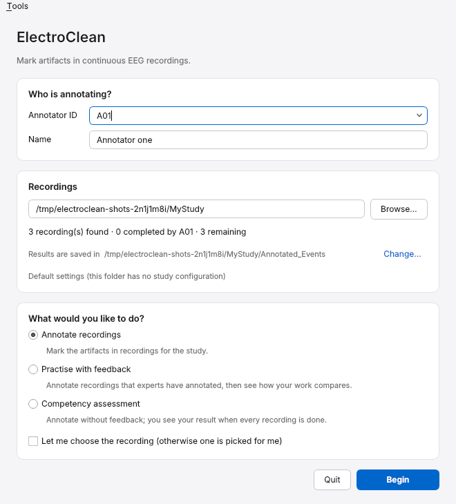
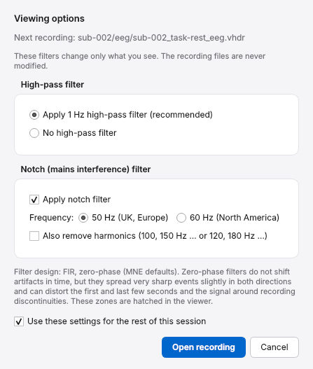
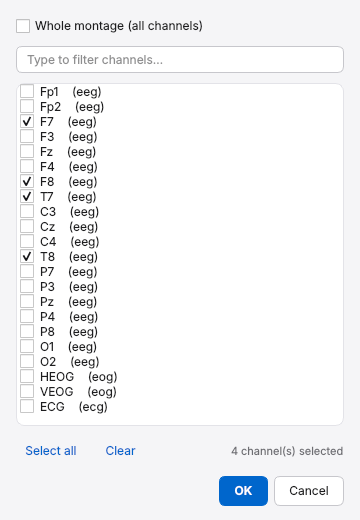
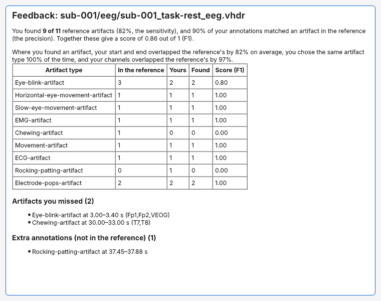
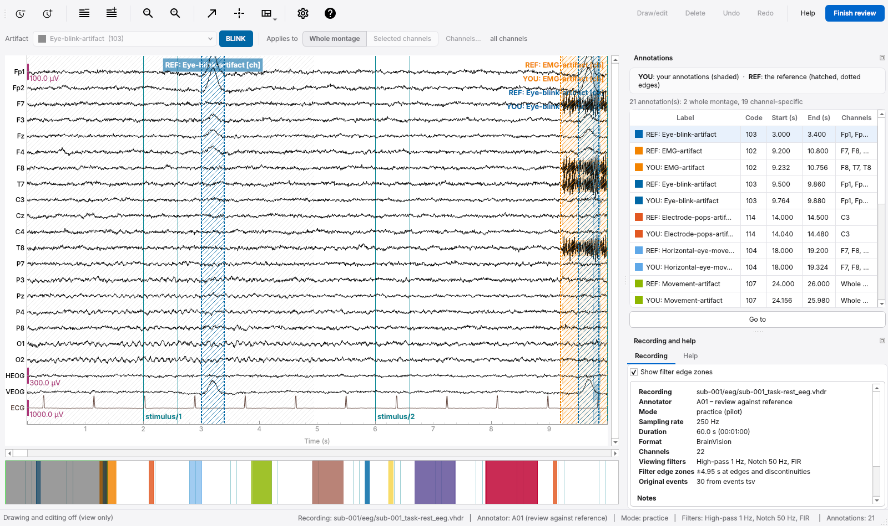
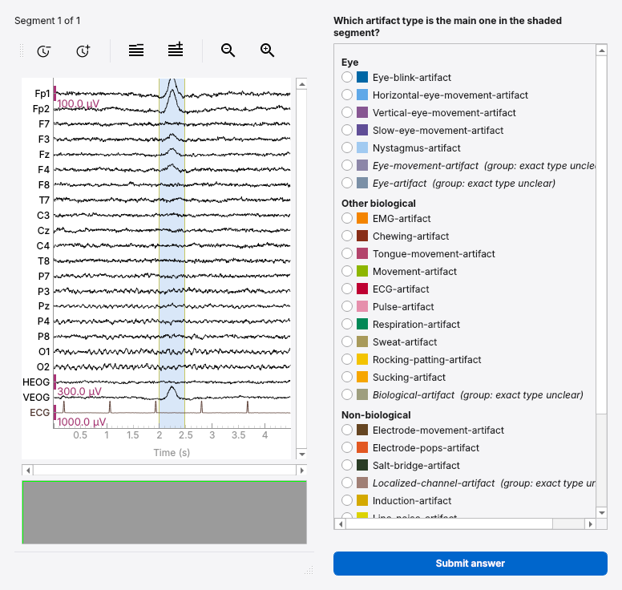

# User guide for annotators

This guide takes you through an annotation session from start to finish. You
do not need to use Python: start ElectroClean with the launcher your study
administrator gave you (or the `electroclean` command).

## 1. Starting a session

**Annotator ID.** Type the identifier your study uses for you, for example
`A01`. It may contain only letters and digits, and it is written in capitals
in every file name (so `a01` and `A01` are the same person). If the study has
a list of annotators, pick yourself from the drop-down list. The ID used last
on the computer is in that list too, but it is never filled in for you, so on
a shared computer nobody saves work under someone else's ID by mistake. The
display name is optional and is only stored inside the session files.

**Dataset folder.** Choose the folder that holds the recordings. ElectroClean
looks through it and all its sub-folders for recordings whose file name ends
in `_eeg.vhdr` (BrainVision), `_eeg.edf` (EDF or EDF+) or `_eeg.bdf` (BDF). The window then shows how many recordings it
found and how many you have already completed (*Begin* stays
unavailable until a folder with recordings is chosen). The *Results folder* is where
your work is saved (normally `Annotated_Events` inside the dataset folder).
If the line *Study settings* names a study, your administrator has configured
this dataset, for example by fixing the viewing filters or assigning
recordings to you.

**What would you like to do?** Choose *Annotate recordings* for research
annotation, or *Practise with feedback* or *Competency assessment* (section 7);
the choice of reference set and activity appears when one of these two is
chosen. Leave *Let me choose the recording* unticked unless your administrator
asks you to choose; normally a recording you have not yet completed is picked
for you.

Press **Begin**, the blue button. Each window has one blue button, for the
step that moves you forward (Begin, Open recording, Save and Finish).

## 2. Viewing options

Before each recording opens you choose the filters used for display. By
default a 1 Hz high-pass filter and a 50 Hz notch filter (the mains frequency
in the UK and Europe) are applied. Choose 60 Hz if your recordings were made
where the mains supply is 60 Hz (as in North America). The filters are
zero-phase FIR filters (MNE-Python's defaults) for everyone. These filters
change only what you see: the recording file is never changed. If your administrator has fixed the filters, the options are shown
but cannot be changed. Tick *Use these settings for the rest of this session*
to skip this window for the next recordings.

Filters with zero phase do not move artifacts in time, but they smear very
sharp events slightly forwards and backwards and distort the first and last
few seconds of the recording and the signal around any break in the
recording. These zones are hatched in grey in the viewer. When you mark an
artifact near them, mark where the underlying event starts and ends.

## 3. The annotation window

The large panel is MNE-Python's EEG browser. Channel names are on the left,
time in seconds along the bottom, and the overview bar at the bottom shows
the whole recording, with your annotations in their colours and the part on
screen outlined (click it to jump). Teal vertical
lines are the **original experimental events** recorded during the session;
they are shown for reference and cannot be changed. A stretch cross-hatched in
darker grey has no recorded data (EDF+ files mark it as `BAD_ACQ_SKIP`, for
example the padding at the very end of many EDF files); there is nothing there
to annotate. Some headsets store information about the recording itself
(timestamps, sample counters, contact quality, battery) as extra channels;
these are not shown and cannot be annotated, and the *Recording* panel says
how many were hidden.

Moving around:

| Key or action | Effect |
|---|---|
| ← / → | Scroll back or forward by a quarter page (with Shift: a full page) |
| ↑ / ↓ | Scroll through channels |
| Home / End (Mac: fn+← / fn+→) | Show less or more time |
| Page Up / Page Down (Mac: fn+↑ / fn+↓) | Show fewer or more channels |
| − / + | Decrease or increase amplitude |
| Click on the EEG | Place a time cursor showing the exact time |
| x | Crosshair showing time and amplitude |
| Scroll bars and overview bar | Move through time and channels |

ElectroClean's controls are in two rows at the top. To the right of MNE's
icons are **Draw/edit**, **Delete**, **Undo**, **Redo**, **Save and Finish**
and **Help**; the row below holds what you draw: the *Artifact* menu and the
choice between the whole montage and selected channels. The *Artifact* menu
shows the **active artifact type** by name, and the coloured box next to it
shows its colour with its short code (for example `CHEW`), so you never rely
on colour alone. The menu does not take the keyboard, so the arrow and page
keys always move through the EEG. Selected channels are drawn in magenta. The
amplitude scale (− and +), the number of seconds and the number of channels
you choose stay the same for the next recording you open. When experimental
events are close together, only the labels that fit are written at the
bottom of the plot; hold the mouse over an event line to see its label. The panel on the right lists
every annotation you have made; below it, the *Recording* tab shows details of
the recording, the filters and any warnings, and the *Help* tab repeats these
instructions. The status bar at the bottom always shows the recording, your
ID, the mode, the filters and the number of annotations.

## 4. Marking artifacts

1. Choose the **artifact type** in the toolbar. Every artifact term of
   HED SCORE 2.2.0 is available (29 terms), listed under four headings: eye,
   other biological, non-biological and type unknown. Hover over an entry to
   see its definition. Most terms are specific types, such as
   Eye-blink-artifact (103). The terms in italics are **group terms**, such
   as Eye-movement-artifact (133) or Data-artifact (130): use them only when
   you can see that there is an artifact of that family but cannot tell which
   type it is.
2. Choose what it affects with the two-part switch after *Applies to*:
   * **Whole montage** marks the interval on every channel.
   * **Selected channels** marks only the channels you choose. Click channel
     names or traces to select or deselect them (they turn magenta), or use
     **Channels…**. Clicking a channel in ElectroClean never marks it as
     bad.
3. **Drag** across the EEG from the start to the end of the artifact. The new
   annotation appears as a shaded band labelled with its type; channel-specific
   annotations are shaded more strongly on their channels and carry `[ch]` in
   their label.

You can drag over an existing annotation to add an overlapping one of a
different type, for example muscle activity during an eye blink; the two stay
separate. If you draw (or move) an annotation so that it overlaps another
annotation **of the same type on the same channels**, ElectroClean merges
them into one annotation covering both, and says so in the status bar.
Ctrl+Z (Cmd+Z on a Mac) undoes the change and the merge together. Annotations
of the same type that only touch, or that are on different channels, are not
merged.

Boundaries are snapped to the nearest sample, so what you save is exactly
what the data allow.

## 5. Checking and changing annotations

Click an annotation (or its row in the *Annotations* list) to select it. Then:

| To | Do this |
|---|---|
| Resize | Drag its left or right edge |
| Move | Hold Shift and drag the middle |
| Add or remove one channel | Hold Shift and click that channel inside the annotation |
| Change type, edit channels, make whole-montage, delete | Right-click it |
| Delete | Press Delete (or Backspace); with several rows selected in the list, all of them are deleted |
| Set exact start and end times | Select it in the list and press **Edit times…** |
| Merge annotations of the same type | Select them in the list (Ctrl/Cmd-click) and press **Merge** |
| Undo or redo | Ctrl+Z, and Ctrl+Y or Ctrl+Shift+Z (Cmd on a Mac) |

Selecting a row in the list jumps to that annotation. Turn **Draw/edit** off
if you want to inspect the recording without any risk of changing your
annotations: while it is off, nothing can be drawn, moved, relabelled, edited
or deleted, by mouse, keyboard or the panel.

## 6. Saving

When you have reviewed the whole recording, press **Save and Finish**. You
will see a summary of your annotations and be asked to confirm. If you marked
nothing, ElectroClean asks you to confirm that the recording has no artifacts;
that is a valid result.

ElectroClean then writes your results, reads them back to check them, and
only then records the recording as completed by you. If anything goes wrong
(for example the network drive disconnects), you will see a message saying
the recording has **not** been marked complete; your annotations stay open and
you can try again. Afterwards you can continue with another recording, go
back to the start window (to change the mode, the dataset or the annotator),
or quit.

**Your work is saved automatically.** While a recording is open,
ElectroClean keeps a copy of your annotations and of the time you have spent,
updated every few seconds. If the computer or ElectroClean stops, nothing is
lost: the next time you start, ElectroClean asks *Continue unfinished work?*
and reopens the recording with your annotations. An automatic copy is not a
result: the recording only counts as done after Save and Finish.

If you close the window without saving, you can choose:

* **Close and finish later**: your annotations and time are kept, and
  ElectroClean offers to continue the next time you start or open this
  recording;
* **Discard and close**: your annotations for this recording are deleted
  (after a second confirmation) and the recording stays incomplete;
* **Keep annotating**.

**Time.** ElectroClean measures how long you spend on each recording, from
the moment the viewer is ready until you press Save and Finish. If you finish
a recording over several sessions, the times are added up. The clock is shown
in the *Recording* tab.

**If a recording cannot be opened**, you will see *Failed to load file. Would
you like to continue with another recording or quit?* with the recording and
the reason (the full technical message is under *Show Details*). The problem
is logged for the administrator and that recording is not offered again until
it has been fixed.

## 7. Training and assessment

Your administrator may ask you to practise on reference recordings and then
complete an assessment.

**Practise with feedback.** Choose *Practise with feedback* on the start window,
then the reference set and *Continuous recordings* as the activity. Annotate as usual. After Save and Finish you see how your
annotations compare with the reference: how many reference artifacts you
found, which you missed, which of yours are not in the reference, and where
you chose a different type.

Press **Review in the viewer** to see your annotations (`YOU:`, shaded) and
the reference (`REF:`, hatched with dotted edges) together. The review window
is read-only; press **Finish review** (or close the window) when you are done.
The window title shows how far you are, for example "practice recording 2 of
5".

**Competency assessment.** Choose *Competency assessment*, the reference set
and *Continuous recordings*. You annotate the
assessment recordings without feedback. When all of them are complete,
ElectroClean shows your result and the criteria you were assessed against,
and tells you what to do next. The full report, with the details of every
recording, is saved for your study administrator.

**Short-segment quiz.** Some reference sets include a quiz (choose
*Short-segment quiz* as the activity): you see short
EEG segments, one at a time, and choose the main artifact type in the shaded
part. The answers are grouped under the same headings as in the annotation
window; a group term (in italics) is the right choice when the exact type
cannot be told. In the practice version you see the answer and an explanation
after each segment; in the assessment version you see your score at the end. If you close
the quiz window before the end, ElectroClean asks for confirmation and saves
the answers given so far, marked as incomplete.

## 8. Questions annotators often ask

*Can two people annotate the same recording?* Yes. Completion is recorded
separately for each annotator, so a recording you have finished stays
available to others.

*I opened the same recording on two computers.* ElectroClean refuses to open a
recording that you already have open elsewhere, to protect your work.

*Where is my work?* In the results folder, under `annotator-<your ID>`, in
sub-folders that mirror the dataset (see the README for the five files).
Training and assessment work is kept separately under `training`.

*My computer crashed while I was annotating.* Start ElectroClean again with
the same annotator ID and dataset: it offers to continue the unfinished
recording with your annotations and time restored.

*Why did two of my annotations become one?* They were of the same type, on
the same channels and overlapped in time, so ElectroClean merged them. If
that was not what you meant, press Ctrl+Z (Cmd+Z on a Mac).

*When should I use a group term such as Eye-artifact?* Only when the type
is unclear. Choosing the specific type whenever you can makes the
annotations more useful; the agreement analysis still credits a group term as
agreement on the artifact family.
